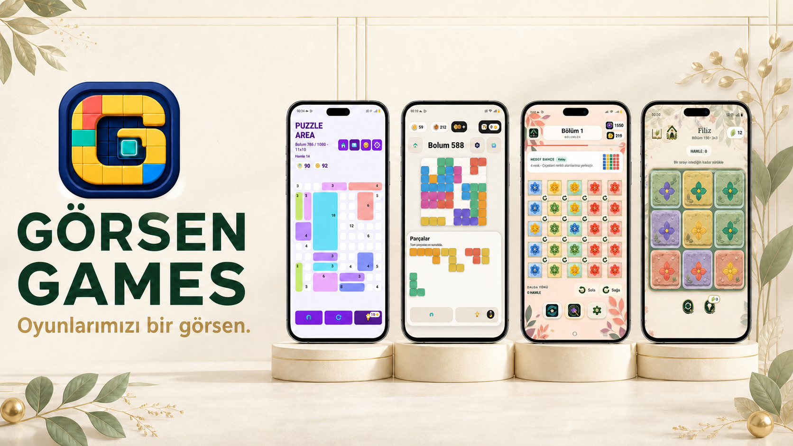

# Görsen Games — Resmî Stüdyo Web Sitesi

<p align="center">
  <a href="https://gorsengames.com">
    
  </a>
</p>

<p align="center">
  Görsen Games'in mobil bulmaca oyunlarını tek bir yerde tanıtan, Türkçe ve İngilizce dil desteğine sahip resmî stüdyo web sitesi.
</p>

<p align="center">
  <a href="https://gorsengames.com"><strong>Canlı siteyi görüntüle</strong></a>
  ·
  <a href="https://play.google.com/store/apps/developer?id=G%C3%B6rsen+Games">Google Play</a>
  ·
  <a href="https://apps.apple.com/tr/developer/gorkem-enol/id6800594942?l=tr">App Store</a>
</p>

## Proje hakkında

Bu proje, bağımsız mobil oyun stüdyosu Görsen Games için tasarlanmış ve geliştirilmiş çok sayfalı bir tanıtım sitesidir. Ziyaretçiler oyun koleksiyonunu keşfedebilir, her oyun için ayrıntılı tanıtım sayfalarını inceleyebilir ve App Store veya Google Play bağlantılarına ulaşabilir.

Site; ürün sunumu, marka kimliği, mobil uyumluluk, erişilebilirlik ve arama motoru görünürlüğü birlikte düşünülerek hazırlanmıştır.

## Oyun koleksiyonu

| Oyun | Tür | Platform durumu |
| --- | --- | --- |
| Puzzle Area | Sayı ve alan bulmacası | iOS · Android |
| Block Puzzle Grid | Parça yerleştirme bulmacası | iOS · Android |
| Bloomshift | Renk ve döndürme bulmacası | iOS · Android |
| Petal Shift | Satır ve sütun kaydırma bulmacası | iOS · Android |
| Fudu Hex | Altıgen sayı birleştirme bulmacası | iOS · Android yakında |
| Liva Lights | Gece bahçesi mantık bulmacası | iOS · Android yakında |

## Öne çıkan özellikler

- Masaüstü, tablet ve telefonlar için responsive arayüz
- Türkçe ve İngilizce dil desteği
- Kaydırma hareketiyle ilerleyen oyun vitrinleri
- Her oyun için özgün renk, içerik ve ekran görüntüsü düzeni
- Gerçek App Store ve Google Play yönlendirmeleri
- Open Graph, yapılandırılmış veri, sitemap ve robots yapılandırması
- AdMob doğrulaması için kök dizinde `app-ads.txt`
- Cloudflare Workers üzerinde çalışan global dağıtım
- Hareket azaltma tercihini destekleyen erişilebilir animasyonlar

## Kullanılan teknolojiler

- **Next.js 16** ve **React 19**
- **TypeScript**
- **Vinext** ve **Vite**
- **Cloudflare Workers**
- Özel CSS animasyonları ve responsive tasarım sistemi

## Yerel geliştirme

### Gereksinimler

- Node.js `22.13.0` veya üzeri
- npm

### Kurulum

```bash
git clone https://github.com/gogosenl/gorsengames-website.git
cd gorsen-games-website
npm install
npm run dev
```

Geliştirme sunucusunun verdiği yerel adresi tarayıcıda açabilirsiniz.

## Kullanılabilir komutlar

| Komut | Açıklama |
| --- | --- |
| `npm run dev` | Yerel geliştirme sunucusunu başlatır |
| `npm run build` | Üretim derlemesini oluşturur |
| `npm run start` | Üretim derlemesini yerel olarak çalıştırır |
| `npm test` | Derlemeyi ve temel site kontrollerini çalıştırır |
| `npm run lint` | Kod kalitesi kontrollerini çalıştırır |
| `npm run deploy` | Siteyi Cloudflare Workers'a gönderir |

## Proje yapısı

```text
app/
  components/       Paylaşılan arayüz ve oyun bileşenleri
  [game]/            Oyun tanıtım sayfaları
  about/             Stüdyo hakkında sayfası
  contact/           İletişim sayfası
  privacy-policy/    Gizlilik politikası
  terms/             Kullanım şartları
public/
  games/             Oyun görselleri
  app-ads.txt        AdMob yetkili satıcı kaydı
tests/               Temel üretim kontrolleri
worker/              Cloudflare Worker giriş noktası
```

## Dağıtım

Proje Cloudflare Workers için yapılandırılmıştır. Dağıtım yapmadan önce Wrangler ile Cloudflare hesabınıza giriş yapın:

```bash
npx wrangler login
npm run deploy
```

Alan adı ve DNS ayarları kaynak koddan bağımsız olarak Cloudflare panelinden yönetilir. E-posta, API anahtarı veya erişim tokenı gibi gizli bilgiler repoya eklenmemelidir; yerel değerler `.env*` veya `.dev.vars*` dosyalarında tutulmalıdır.

## Tasarım ve geliştirme

Görkem Şenol tarafından Görsen Games için tasarlanmış ve geliştirilmiştir.

## Kullanım hakları

Kaynak kodu incelemeye açıktır. Marka, oyun adları, görseller ve diğer içeriklerin tüm hakları Görsen Games'e aittir. Açık kaynak lisansı verilmemiştir.
